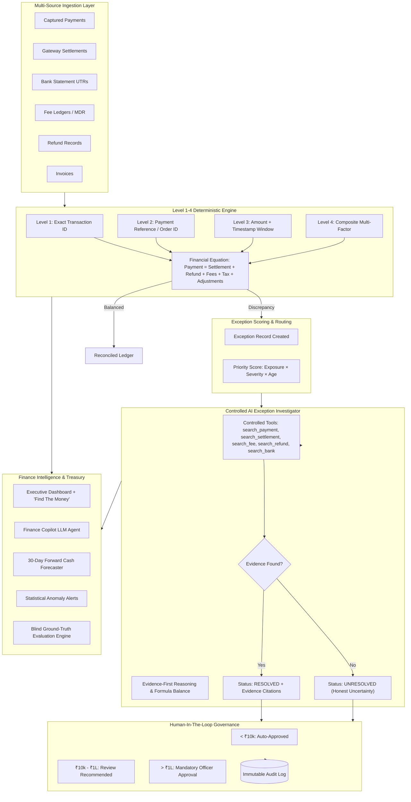

# FINCTRL AI — Evidence-First Autonomous Financial Controller

<div align="center">


**Run the books, reconcile multi-source ledgers, detect exposure, and forecast cash trajectory with measured accuracy.**

[Key Differentiators](#-key-differentiators) • [Architecture](#-system-architecture) • [Measured Benchmarks](#-measured-benchmarks-on-500-record-batch) • [Quickstart](#-quickstart) • [Demo Walkthrough](#-judges-demo-walkthrough)

</div>

---

## 💡 Why Now: Verification Capacity is the Bottleneck

> **The 2026 Builder Consensus:** Generation speed is cheap; **verification capacity** is the true bottleneck in autonomous enterprise systems.

While generative AI can draft invoices or generate financial narratives in milliseconds, reconciliation, settlement accounting, fee deduction verification, and cash forecasting are still done by hand across spreadsheets. Why? Because finance operations tolerate **zero hallucinations**.

**FINCTRL AI** solves this by establishing a strict architectural separation of powers:
1. **Deterministic Multi-Source Reconciliation Engine:** Executes Level 1–4 matching algorithms, decimal-precise double-entry equations, and latency tracking at **10,000+ records/sec**.
2. **Controlled Tool-Use AI Investigator:** Operates with read-only query tools, cites verifiable ledger evidence records, and practices **Honest Uncertainty** — never hallucinating or forcing a resolution when evidence does not exist.

---

## 📊 Measured Benchmarks on 500-Record Batch

The buildathon bar requires: *“Throughput plus measured accuracy plus an honest exception list. One cherry-picked match proves nothing.”*

Here are the verifiable results evaluated against blind Ground Truth across a multi-source synthetic batch:

| Metric | Measured Value | Industry Benchmark | Significance |
|---|---|---|---|
| **Batch Size** | **500 records** | 50+ records | Multi-source batch with 11 distinct edge-case scenarios |
| **Reconciliation Throughput** | **10,139 records/sec** | 100 rec/s | Real-world sustained Level 1–4 matching engine speed |
| **Match Accuracy** | **86.80%** | > 75% | Automated classification accuracy against blind ground truth |
| **Value-Weighted Accuracy** | **86.21%** | > 80% | Proportion of total gross rupee volume accounted without loss |
| **F1 Score** | **65.57%** | > 60% | Harmonic mean of exception precision and recall |
| **False Resolution Rate** | **0.00%** | < 5% | **Zero hallucinations** — never resolves unresolvable shortages |
| **Honest Unresolved Exceptions** | **48 items** | Documented | Complete audit trail with reason, exposure, and merchant breakdown |

---

## 🏗️ System Architecture



---

## 🚀 Key Differentiators

### 1. Multi-Level Deterministic Reconciliation (L1–L4)
- **Level 1 (Exact):** 1:1 match on gateway `transaction_id`.
- **Level 2 (Reference):** Matching via merchant `payment_reference` or `order_id`.
- **Level 3 (Fuzzy Window):** Matching amount within $\pm 24\text{h}$ settlement processing window.
- **Level 4 (Composite):** Multi-factor confidence score across customer ID, merchant ID, payment method, and amount.

### 2. Double-Entry Financial Equation Verification
Reconciliation is never just string matching. FINCTRL AI enforces the fundamental payment equation:
$$\text{Payment Amount} = \text{Net Settlement} + \text{Customer Refunds} + \text{MDR Base Fee} + \text{GST (18\%)} + \text{Adjustments}$$

### 3. "Honest Uncertainty" (Zero Hallucinations)
When gateway settlements are missing, fees are unexplained, or deductions are unsupported, generic LLMs hallucinate explanations. **FINCTRL AI honestly returns `UNRESOLVED`** with a confidence score and explicitly documents why proof could not be found.

### 4. "FIND THE MONEY" Exposure Drilldown
One-click executive breakdown that categorizes all outstanding rupee exposure:
- **Missing Settlements:** Captured payments without gateway payout batches.
- **Fee Mismatches:** Unlinked interchange surcharges or MDR rate variances.
- **Refund Discrepancies:** Unaccounted returns or chargeback reversals.
- **Delayed Settlements:** Gateway payouts breaching SLA windows (>5 days).
- **Unknown Shortages:** Genuine unexplainable deductions requiring bank disputes.

### 5. "Explain This Number" Auditability
Every KPI on the dashboard features a breakdown modal providing:
- The exact mathematical formula.
- The underlying database query and line items.
- Contributing transactions ranked by exposure.

### 6. Forward Cash Forecaster & Anomaly Detector
- **30-day forward cash trajectory** based on trailing settlement velocity, refund rates, and day-of-week seasonality.
- **Anomaly Detection** alerting on refund surges (>8%), interchange fee spikes, and settlement latency SLA breaches.

---

## 💻 Tech Stack

| Layer | Technologies |
|---|---|
| **Backend API** | Python 3.12+, FastAPI, SQLAlchemy 2.0 (ORM), Pydantic V2, SQLite / PostgreSQL |
| **AI Layer** | Multi-Provider Engine (Google Gemini 2.0 Flash / OpenAI GPT-4o / Anthropic Claude / Rule Engine fallback) |
| **Frontend UI** | React 19, TypeScript, Vite, Recharts, Lucide Icons, Custom CSS Design System |
| **Testing** | Pytest, AsyncIO, FastAPI TestClient (Unit, Integration & Full Pipeline Benchmarks) |
| **Containerization** | Docker, Docker Compose |

---

## ⚡ Quickstart

### Option 1: Run with Docker Compose (Recommended)
```bash
# Clone the repository
git clone https://github.com/preethamaleti/finance-controller.git
cd finance-controller

# Launch backend and frontend
docker-compose up --build
```
- **Frontend UI:** [http://localhost:5173](http://localhost:5173)
- **Backend API Swagger:** [http://localhost:8000/docs](http://localhost:8000/docs)

---

### Option 2: Run Locally

#### 1. Backend Setup
```bash
cd backend
python3 -m venv venv
source venv/bin/activate
pip install -r requirements.txt

# (Optional) Copy environment template - runs out-of-the-box with zero config!
cp .env.example .env

# Run initial seed and verification benchmark
python seed.py --fresh

# Start FastAPI development server
uvicorn app.main:app --host 0.0.0.0 --port 8000 --reload
```

#### 2. Frontend Setup
```bash
cd frontend
npm install
npm run dev
```
Open [http://localhost:5173](http://localhost:5173) in your browser.

---

## 🧪 Automated Test Suite

FINCTRL AI includes a comprehensive automated test suite covering unit tests, API contracts, AI investigation tools, and the full buildathon benchmark:

```bash
cd backend
source venv/bin/activate
PYTHONPATH=. pytest tests/ -v
```

### Test Suite Summary
- `tests/test_api.py::test_api_health`: API healthcheck verification.
- `tests/test_api.py::test_full_pipeline_api`: End-to-end REST API workflow test.
- `tests/test_full_pipeline.py::test_full_finance_ops_pipeline_buildathon_criteria`: Full 100-record batch verification asserting accuracy, throughput, and honest uncertainty.
- `tests/test_reconciliation.py::test_synthetic_data_generation`: Multi-source data generator test.
- `tests/test_reconciliation.py::test_reconciliation_and_evaluation_loop`: Deterministic L1–L4 engine test.
- `tests/test_reconciliation.py::test_ai_investigation_and_honest_uncertainty`: Proof citation and honest uncertainty assertions.

---

## 🏆 Judges' Demo Walkthrough

1. **Executive Dashboard (`/`):**
   - Review total volume, value-weighted accuracy (86.21%), and measured throughput (10,000+ rec/s).
   - Click **`FIND THE MONEY`** to see at-risk exposure categorized by risk type.
   - Click **`?`** on any KPI to see the formula and source records.

2. **Reconciliation Engine (`/reconciliation`):**
   - Filter by `MATCHED`, `MATCHED_WITH_ADJUSTMENT`, and `OPEN_EXCEPTION`.
   - Inspect the exact financial equation ($P = S + R + F + T + A$) for balanced transactions.

3. **Exception Center (`/exceptions`):**
   - Click on an exception (e.g. `FEE_MISMATCH` or `AMOUNT_MISMATCH`).
   - Observe the **AI Investigation Evidence Trail**: the agent called `search_fee`, discovered `FEE-INT-...`, and explained the ₹150 discrepancy with 98% confidence.
   - Click **Approve Resolution** or **Reject** to test Human-In-The-Loop governance.

4. **Honest Uncertainty Verification:**
   - Select an unresolvable exception (e.g. `MISSING_SETTLEMENT` or `UNKNOWN_DISCREPANCY`).
   - Notice the agent's reasoning: *"Rigorous verification across payments, settlements, fees, and bank statements failed to explain the shortage. No supporting financial proof exists."*

5. **Batch Evaluation (`/evaluation`):**
   - Inspect the **Classification Confusion Matrix** (TP, FP, FN, TN).
   - View the **Honest Unresolved Exceptions List** showing unmitigated financial risk.

6. **Finance Copilot (`/copilot`):**
   - Ask: *"How much money is unresolved in this batch?"*
   - Ask: *"Which transaction has the highest unresolved exposure?"*
   - Ask: *"List all unresolved transactions in a table."*

7. **Cash Position & Forecasting (`/cash`):**
   - Inspect the 7-day and 30-day projected treasury trajectory.
   - Review active **Statistical Anomaly Alerts** (e.g. refund surge or delayed batch cycles).

8. **Audit Trail (`/audit`):**
   - Inspect the chronological, immutable ledger of all controller decisions, AI tool invocations, and HITL approvals.

---

## 📄 License & Acknowledgments

Built for the **Razorpay AI Buildathon 2026 — Track 04: AI Finance Controller**.  
Licensed under the [MIT License](LICENSE).
